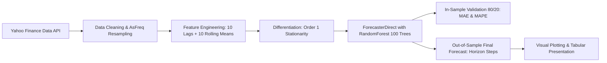

<div align="center">

# 🚀 Yahoo Finance Forecaster Suite

### Machine Learning Time Series Forecasting for Financial Markets — Available in both Terminal CLI & Modern Desktop GUI.

[](https://www.python.org/)
[](LICENSE)
[](https://skforecast.org/)
[](https://scikit-learn.org/)
[](https://finance.yahoo.com/)
[](CONTRIBUTING.md)

</div>

---

## 📖 Table of Contents

- [About The Suite](#-about-the-suite)
- [Editions Comparison](#-editions-comparison)
- [Machine Learning Architecture](#-machine-learning-architecture)
- [Quick Start](#-quick-start)
- [Repository Structure](#-repository-structure)
- [License](#-license)

---

## 🌟 About The Suite

**Yahoo Finance Forecaster Suite** is an open-source machine learning platform designed to forecast future stock prices, market indices, commodities, and digital assets using data fetched directly from Yahoo Finance.

The suite provides two distinct editions tailored to your preferred workflow:
1. **[Yahoo Finance Forecaster CLI](Yahoo%20Finance%20Forecaster%20CLI)**: Lightweight, ultra-fast terminal tool for automation, servers, and keyboard-first power users.
2. **[Yahoo Finance Forecaster GUI](Yahoo%20Finance%20Forecaster%20GUI)**: Interactive desktop application with synchronized visual charts, multi-threaded computation, tabular predictions with price changes, CSV export, and built-in tutorials.

---

## ⚖️ Editions Comparison

| Feature | 📈 CLI Edition | 📊 GUI Edition |
|---|:---:|:---:|
| **Interface** | Command Line (Terminal) | Desktop Graphical User Interface |
| **Technology** | Pure Python + ANSI formatting | Tkinter + TTK + Matplotlib Canvas |
| **Interactive Visualization** | Pop-up HD Matplotlib Window | Embedded Canvas + HD Pop-up Window |
| **Data Export** | Terminal ASCII Table | 1-Click CSV Export |
| **Execution Mode** | Synchronous | Asynchronous Background Threading |
| **Preset Shortcuts** | Interactive prompts | 1-Click Year Presets + Auto-Caps Ticker |
| **Documentation** | Built-in CLI help | Built-in Tutorial Tab & Real-time Logs |
| **Directory** | [`Yahoo Finance Forecaster CLI`](Yahoo%20Finance%20Forecaster%20CLI) | [`Yahoo Finance Forecaster GUI`](Yahoo%20Finance%20Forecaster%20GUI) |

---

## 🏗️ Machine Learning Architecture

Both editions share an identical, verified machine learning architecture designed to deliver reliable multi-step predictions without slow hyperparameter searches:



- **Forecaster Strategy**: `skforecast.direct.ForecasterDirect` (step-by-step estimators to eliminate error propagation).
- **Core Algorithm**: `RandomForestRegressor(n_estimators=100, random_state=42, n_jobs=-1)`.
- **Autoregressive Features**: 10 lag variables (`lag_1` through `lag_10`).
- **Rolling Window Features**: 10 rolling averages (`roll_mean_1` through `roll_mean_10`).
- **Total Predictors**: 20 engineered features.

---

## 🚀 Quick Start

### 1. Prerequisites
- **Python 3.9+** (Python 3.10, 3.11, 3.12, 3.13 tested).
- Internet connection for Yahoo Finance market data.

### 2. Setup
```bash
# Clone the repository
git clone https://github.com/USERNAME/yahoo-finance-forecaster.git
cd yahoo-finance-forecaster

# Create virtual environment
python -m venv venv
# Windows:
venv\Scripts\activate
# Linux / macOS:
source venv/bin/activate
```

### 3. Launching

#### To run the CLI Edition:
```bash
cd "Yahoo Finance Forecaster CLI"
pip install -r requirements.txt
python main.py
```

#### To run the GUI Edition:
```bash
cd "Yahoo Finance Forecaster GUI"
pip install -r requirements.txt
python app.py
# Or on Windows, simply double-click run_gui.bat
```

---

## 📁 Repository Structure

```text
C:\Open Source
├── .gitignore                          # Global Git ignore rules
├── LICENSE                             # MIT License
├── README.md                           # Suite master documentation
│
├── Yahoo Finance Forecaster CLI/       # CLI Edition
│   ├── .gitignore
│   ├── CONTRIBUTING.md
│   ├── LICENSE
│   ├── README.md
│   ├── requirements.txt
│   └── main.py
│
└── Yahoo Finance Forecaster GUI/       # GUI Edition
    ├── .gitignore
    ├── CONTRIBUTING.md
    ├── LICENSE
    ├── README.md
    ├── requirements.txt
    ├── run_gui.bat
    ├── run_gui_debug.bat
    └── app.py
```

---

## 📜 License

This project is licensed under the **MIT License** — see the [LICENSE](LICENSE) file for details.
