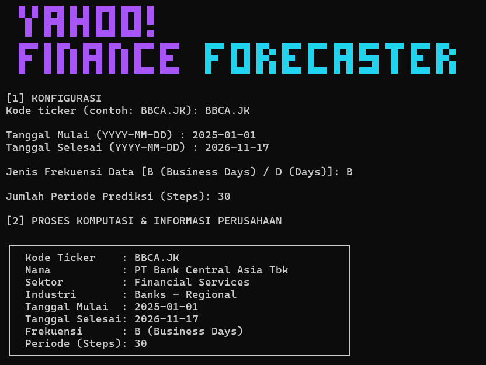
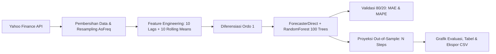

<div align="center">

  

  <p>
    <strong>Platform Peramalan Deret Waktu (<em>Time Series</em>) Pasar Keuangan Berbasis Machine Learning</strong><br/>
    <strong>Tersedia dalam Edisi Terminal CLI dan Desktop GUI.</strong>
  </p>

  <p>
    Proyeksikan pergerakan harga saham, indeks pasar, komoditas, dan aset kripto secara langsung dari data Yahoo Finance tanpa memerlukan <em>hyperparameter tuning</em> manual yang lambat.
  </p>

  <p>
    <a href="https://github.com/Cahyo-Wisanggeni/Yahoo-Finance-Forecaster/releases"></a>
    <a href="https://www.python.org/"></a>
    <a href="LICENSE"></a>
    <a href="https://skforecast.org/"></a>
    <a href="https://finance.yahoo.com/"></a>
  </p>

  <p>
    <a href="Yahoo%20Finance%20Forecaster%20CLI">Edisi CLI</a> &middot;
    <a href="Yahoo%20Finance%20Forecaster%20GUI">Edisi GUI</a> &middot;
    <a href="#pratinjau-antarmuka">Pratinjau</a> &middot;
    <a href="#panduan-memulai-cepat">Panduan Memulai</a> &middot;
    <a href="CHANGELOG.md">Catatan Perubahan</a>
  </p>

</div>

---

## Daftar Isi

- [Keunggulan Utama](#keunggulan-utama)
- [Pratinjau Antarmuka](#pratinjau-antarmuka)
- [Perbandingan Edisi](#perbandingan-edisi)
- [Panduan Memulai Cepat](#panduan-memulai-cepat)
- [Parameter & Contoh Penggunaan](#parameter--contoh-penggunaan)
- [Arsitektur Machine Learning](#arsitektur-machine-learning)
- [Struktur Repositori](#struktur-repositori)
- [Kontribusi & Catatan Perubahan](#kontribusi--catatan-perubahan)
- [Lisensi](#lisensi)

---

## Keunggulan Utama

- **Peramalan Multi-Langkah Bebas Akumulasi Galat**: Menggunakan strategi `ForecasterDirect` dari `skforecast` yang melatih estimator khusus untuk setiap langkah horizon ke depan, dipadukan dengan `RandomForestRegressor` (100 *decision trees*).
- **20 Fitur Rekayasa Otomatis**: Menggabungkan 10 variabel lag autoregresif (`lag_1`–`lag_10`), 10 *rolling window means* (`roll_mean_1`–`roll_mean_10`), serta diferensiasi ordo pertama agar deret harga stasioner sebelum pelatihan.
- **Evaluasi Model Transparan**: Pemisahan data latih dan uji (80/20) secara otomatis menghitung metrik **MAE** (*Mean Absolute Error*) dan **MAPE** (*Mean Absolute Percentage Error*) sebelum menghasilkan proyeksi *out-of-sample*.
- **Dua Antarmuka untuk Setiap Alur Kerja**:
  - **[Edisi CLI](Yahoo%20Finance%20Forecaster%20CLI)**: Ringan dan cepat dengan pewarnaan ANSI modern, tabel ringkasan ASCII di terminal, serta jendela pop-up grafik Matplotlib HD.
  - **[Edisi GUI](Yahoo%20Finance%20Forecaster%20GUI)**: Aplikasi desktop Tkinter *multi-threaded* (anti-freeze) dengan *preset* rentang tahun cepat, deteksi profil emiten otomatis, kanvas grafik interaktif, tabel rincian prediksi, log *real-time*, dan ekspor CSV sekali klik.
- **Cakupan Aset Global**: Mendukung seluruh instrumen yang tersedia di Yahoo Finance—saham domestik (`BBCA.JK`), saham global (`AAPL`), indeks (`^JKSE`), komoditas (`GC=F`), hingga kripto (`BTC-USD`).

---

## Pratinjau Antarmuka

### 1. Edisi Terminal CLI
Antarmuka baris perintah yang interaktif, ringan, dan terstruktur langsung dari terminal:

<div align="center">
  
</div>

<br/>

### 2. Edisi Desktop GUI (v1.0.0)
Aplikasi desktop modern dengan kontrol parameter, preset rentang tanggal instan, profil emiten otomatis, metrik evaluasi (MAPE & MAE), serta grafik proyeksi resolusi tinggi:

<div align="center">
  
</div>

---

## Perbandingan Edisi

| Fitur | Edisi CLI | Edisi GUI |
|---|:---:|:---:|
| **Antarmuka** | Baris Perintah (*Terminal*) | Antarmuka Grafis Desktop (*GUI*) |
| **Teknologi** | Python Murni + Format ANSI | Tkinter + TTK + Matplotlib Canvas |
| **Visualisasi** | Jendela Pop-up HD Matplotlib | Kanvas Tersemat + Pop-up HD |
| **Ekspor Data** | Tabel ASCII Terminal | Ekspor CSV Sekali Klik (`prediksi_<ticker>_<timestamp>.csv`) |
| **Mode Eksekusi** | Sinkron (*Synchronous*) | *Multi-Threading* Latar Belakang (*Non-Blocking*) |
| **Kemudahan Input** | Validasi Interaktif + Format `YY-MM-DD` / `YYYY-MM-DD` | Tombol *Preset* (1–5 Tahun) + *Auto-Uppercase* Ticker |
| **Info Emiten & Log** | Ringkasan Progres Terminal | Deteksi Sektor/Industri + Log Berpenanda Waktu |
| **Dokumentasi Bawaan** | Flag `--version` / `-v` & Panduan Terminal | Tab Tutorial Terintegrasi di Dalam Aplikasi |
| **Direktori** | [`Yahoo Finance Forecaster CLI`](Yahoo%20Finance%20Forecaster%20CLI) | [`Yahoo Finance Forecaster GUI`](Yahoo%20Finance%20Forecaster%20GUI) |

---

## Panduan Memulai Cepat

### 1. Prasyarat Sistem
- **Python 3.9+** (teruji pada Python 3.9 hingga 3.13).
- Koneksi internet aktif untuk mengunduh data pasar dari Yahoo Finance.

### 2. Kloning Repositori & Menyiapkan Virtual Environment

```bash
git clone https://github.com/Cahyo-Wisanggeni/Yahoo-Finance-Forecaster.git
cd Yahoo-Finance-Forecaster

# Membuat dan mengaktifkan virtual environment
python -m venv venv

# Windows (CMD / PowerShell)
venv\Scripts\activate

# Linux / macOS
source venv/bin/activate
```

### 3. Menjalankan Aplikasi

**Edisi Terminal (CLI):**

```bash
cd "Yahoo Finance Forecaster CLI"
pip install -r requirements.txt
python main.py
```

**Edisi Desktop (GUI):**

```bash
cd "Yahoo Finance Forecaster GUI"
pip install -r requirements.txt
python app.py
```

> **Pengguna Windows:** Pada folder `Yahoo Finance Forecaster GUI`, Anda juga dapat mengklik dua kali `run_gui.bat` (atau `run_gui_debug.bat` untuk melihat log konsol) setelah dependensi terpasang.

Verifikasi instalasi kapan saja dengan memeriksa versi aplikasi:

```bash
python main.py --version   # Output: Yahoo Finance Forecaster CLI v1.0.0
python app.py --version    # Output: Yahoo Finance Forecaster GUI v1.0.0
```

---

## Parameter & Contoh Penggunaan

Saat menjalankan aplikasi, Anda cukup memasukkan lima parameter utama berikut:

| Parameter | Format / Pilihan | Keterangan |
|---|---|---|
| **Ticker** | Kode Yahoo Finance | Contoh: `BBCA.JK`, `AAPL`, `^JKSE`, `BTC-USD` |
| **Tanggal Mulai** | `YYYY-MM-DD` atau `YY-MM-DD` | Awal rentang data historis (mis. `2023-01-01` atau `23-01-01`) |
| **Tanggal Akhir** | `YYYY-MM-DD` atau `YY-MM-DD` | Batas akhir data historis yang diunduh |
| **Frekuensi Data** | `B` atau `D` | `B` (*Business Days* / hari bursa) untuk saham, `D` (*Calendar Days*) untuk aset 24/7 seperti kripto |
| **Horizon Prediksi** | Bilangan bulat (`steps`) | Jumlah periode langkah ke depan yang ingin diproyeksikan (mis. `14` atau `30`) |

<details>
<summary><b>Klik untuk melihat contoh daftar ticker populer &amp; frekuensi yang disarankan</b></summary>

| Kategori | Kode Ticker | Keterangan | Frekuensi Disarankan |
|---|---|---|---|
| Saham Indonesia (IDX) | `BBCA.JK`, `TLKM.JK`, `BMRI.JK` | Bursa Efek Indonesia | `B` |
| Saham Global (US) | `AAPL`, `MSFT`, `NVDA` | NASDAQ / NYSE | `B` |
| Indeks Pasar | `^JKSE`, `^GSPC` | IHSG / S&P 500 | `B` |
| Komoditas | `GC=F`, `CL=F` | Emas / Minyak Mentah | `B` |
| Aset Kripto | `BTC-USD`, `ETH-USD` | Perdagangan 24/7 | `D` |

</details>

---

## Arsitektur Machine Learning

Kedua edisi berbagi jalur pemrosesan dan pemodelan yang identik untuk memastikan konsistensi hasil:



| Komponen | Spesifikasi |
|---|---|
| **Strategi Peramalan** | `skforecast.direct.ForecasterDirect` |
| **Estimator Utama** | `RandomForestRegressor(n_estimators=100, random_state=42, n_jobs=-1)` |
| **Fitur Autoregresif** | `lag_1` hingga `lag_10` (10 fitur) |
| **Fitur Rolling Window** | `roll_mean_1` hingga `roll_mean_10` (10 fitur) |
| **Total Prediktor** | 20 fitur deret waktu dengan diferensiasi ordo 1 |
| **Metrik Evaluasi** | MAE (*Mean Absolute Error*) & MAPE (*Mean Absolute Percentage Error*) |

---

## Struktur Repositori

<details>
<summary><b>Klik untuk melihat susunan lengkap direktori dan berkas proyek</b></summary>

```text
Yahoo-Finance-Forecaster/
├── .gitignore                          # Aturan abaikan Git global
├── CHANGELOG.md                        # Catatan perubahan dan riwayat versi
├── LICENSE                             # Lisensi MIT
├── README.md                           # Dokumentasi utama proyek
├── assets/                             # Aset logo & tangkapan layar utama
│   ├── logo_v2.png
│   ├── cli_preview_v2.png
│   └── gui_preview_v2.png
│
├── Yahoo Finance Forecaster CLI/       # Edisi Terminal (CLI)
│   ├── assets/
│   ├── .gitignore
│   ├── CONTRIBUTING.md
│   ├── LICENSE
│   ├── README.md
│   ├── requirements.txt
│   └── main.py
│
└── Yahoo Finance Forecaster GUI/       # Edisi Grafis Desktop (GUI)
    ├── assets/
    ├── .gitignore
    ├── CONTRIBUTING.md
    ├── LICENSE
    ├── README.md
    ├── requirements.txt
    ├── run_gui.bat
    ├── run_gui_debug.bat
    └── app.py
```

</details>

---

## Kontribusi & Catatan Perubahan

- **Kontribusi**: Panduan kontribusi tersedia pada masing-masing direktori edisi ([CLI CONTRIBUTING](Yahoo%20Finance%20Forecaster%20CLI/CONTRIBUTING.md) · [GUI CONTRIBUTING](Yahoo%20Finance%20Forecaster%20GUI/CONTRIBUTING.md)).
- **Riwayat Rilis**: Seluruh pembaruan fitur dan perbaikan terdokumentasi di [CHANGELOG.md](CHANGELOG.md).

> **Catatan:** Seluruh hasil peramalan dihasilkan secara matematis dari data historis untuk keperluan edukasi, riset, dan analisis teknis, bukan merupakan rekomendasi atau saran investasi finansial.

---

## Lisensi

Didistribusikan di bawah lisensi **[MIT License](LICENSE)**.
