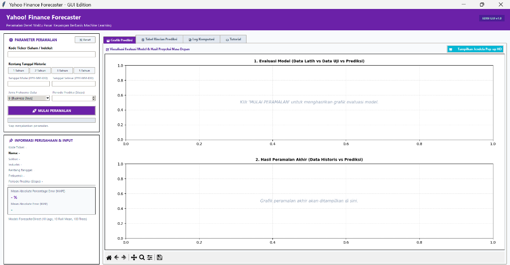
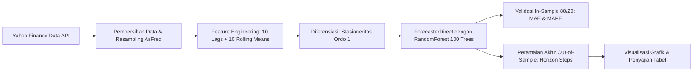

<div align="center">

  

  <p><strong>Platform Peramalan Deret Waktu (<em>Time Series</em>) Pasar Keuangan Berbasis Machine Learning — Tersedia dalam Edisi Terminal CLI & Desktop GUI.</strong></p>

  <p>
    <a href="https://www.python.org/"></a>
    <a href="LICENSE"></a>
    <a href="https://docs.python.org/3/library/tkinter.html"></a>
    <a href="https://matplotlib.org/"></a>
    <a href="https://scikit-learn.org/"></a>
    <a href="https://skforecast.org/"></a>
    <a href="https://finance.yahoo.com/"></a>
  </p>

</div>

---

## Daftar Isi

- [Tentang Platform](#tentang-platform)
- [Pratinjau Antarmuka](#pratinjau-antarmuka)
- [Perbandingan Edisi](#perbandingan-edisi)
- [Arsitektur Machine Learning](#arsitektur-machine-learning)
- [Panduan Memulai Cepat](#panduan-memulai-cepat)
- [Struktur Repositori](#struktur-repositori)
- [Lisensi](#lisensi)

---

## Tentang Platform

**Yahoo Finance Forecaster** adalah platform peramalan berbasis *machine learning open-source* yang dirancang untuk memproyeksikan pergerakan harga saham, indeks pasar, komoditas, dan aset digital menggunakan data historis yang diunduh langsung dari Yahoo Finance.

Platform ini hadir dalam dua edisi yang disesuaikan dengan preferensi alur kerja Anda:
1. **[Yahoo Finance Forecaster CLI](Yahoo%20Finance%20Forecaster%20CLI)**: Alat terminal ringan dan sangat cepat, ideal untuk otomatisasi, lingkungan server, dan pengguna yang mengutamakan efisiensi keyboard.
2. **[Yahoo Finance Forecaster GUI](Yahoo%20Finance%20Forecaster%20GUI)**: Aplikasi desktop interaktif dengan visualisasi grafik tersinkronisasi, komputasi *multi-threaded* (bebas freeze), tabel rincian prediksi beserta perubahan harga, ekspor CSV, dan tab tutorial terintegrasi.

---

## Pratinjau Antarmuka

### 1. Edisi Terminal CLI
Antarmuka baris perintah yang interaktif, cepat, dan terstruktur langsung dari terminal:

<div align="center">
  
</div>

<br/>

### 2. Edisi Desktop GUI (Edisi v1.0)
Aplikasi desktop modern lengkap dengan kontrol parameter, preset rentang tanggal instan, profil emiten, metrik evaluasi (MAPE & MAE), serta grafik proyeksi resolusi tinggi:

<div align="center">
  
</div>

---

## Perbandingan Edisi

| Fitur | Edisi CLI | Edisi GUI |
|---|:---:|:---:|
| **Antarmuka** | Baris Perintah (*Terminal*) | Antarmuka Grafis Desktop (*GUI*) |
| **Teknologi** | Python Murni + Format ANSI | Tkinter + TTK + Matplotlib Canvas |
| **Visualisasi Interaktif** | Jendela Pop-up HD Matplotlib | Matplotlib Canvas Tersemat + Pop-up HD |
| **Ekspor Data** | Tabel ASCII Terminal | Ekspor CSV Sekali Klik (*1-Click*) |
| **Mode Eksekusi** | Sinkron (*Synchronous*) | *Multi-Threading* Latar Belakang (*Asynchronous*) |
| **Preset Cepat** | Input Interaktif | Tombol Preset Rentang Tahun + Auto-Caps Ticker |
| **Dokumentasi** | Bantuan CLI Bawaan | Tab Tutorial Terintegrasi & Log Real-time |
| **Direktori** | [`Yahoo Finance Forecaster CLI`](Yahoo%20Finance%20Forecaster%20CLI) | [`Yahoo Finance Forecaster GUI`](Yahoo%20Finance%20Forecaster%20GUI) |

---

## Arsitektur Machine Learning

Kedua edisi mengimplementasikan arsitektur *machine learning* teruji yang dirancang untuk menghasilkan proyeksi multi-langkah (*multi-step forecast*) yang andal tanpa memerlukan pencarian hiperparameter (*hyperparameter tuning*) yang lambat:



- **Strategi Peramalan**: `skforecast.direct.ForecasterDirect` (melatih estimator khusus untuk tiap langkah ke depan guna mengeliminasi akumulasi kesalahan).
- **Algoritma Utama**: `RandomForestRegressor(n_estimators=100, random_state=42, n_jobs=-1)`.
- **Fitur Autoregresif**: 10 variabel lag waktu (`lag_1` hingga `lag_10`).
- **Fitur Rolling Window**: 10 rata-rata bergerak (`roll_mean_1` hingga `roll_mean_10`).
- **Total Variabel Prediktor**: 20 fitur hasil rekayasa data.

---

## Panduan Memulai Cepat

### 1. Prasyarat Sistem
- **Python 3.9+** (didukung penuh pada Python 3.10, 3.11, 3.12, dan 3.13).
- Koneksi internet aktif untuk mengunduh data pasar Yahoo Finance.

### 2. Kloning Repositori & Menyiapkan Virtual Environment
```bash
# Kloning repositori
git clone https://github.com/Cahyo-Wisanggeni/Yahoo-Finance-Forecaster.git
cd Yahoo-Finance-Forecaster

# Membuat virtual environment
python -m venv venv

# Mengaktifkan virtual environment
# Pada Windows:
venv\Scripts\activate
# Pada Linux / macOS:
source venv/bin/activate
```

### 3. Menjalankan Aplikasi

#### Menjalankan Edisi CLI:
```bash
cd "Yahoo Finance Forecaster CLI"
pip install -r requirements.txt
python main.py
```

#### Menjalankan Edisi GUI:
```bash
cd "Yahoo Finance Forecaster GUI"
pip install -r requirements.txt
python app.py
# Atau di Windows, cukup klik dua kali file run_gui.bat
```

---

## Struktur Repositori

```text
Yahoo-Finance-Forecaster/
├── .gitignore                          # Aturan abaikan Git global
├── LICENSE                             # Lisensi MIT
├── README.md                           # Dokumentasi utama proyek
├── assets/                             # Tangkapan layar & logo visual
│   ├── logo.png
│   ├── cli_preview.png
│   └── gui_preview.png
│
├── Yahoo Finance Forecaster CLI/       # Edisi Terminal (CLI)
│   ├── assets/
│   │   ├── logo.png
│   │   └── cli_preview.png
│   ├── .gitignore
│   ├── CONTRIBUTING.md
│   ├── LICENSE
│   ├── README.md
│   ├── requirements.txt
│   └── main.py
│
└── Yahoo Finance Forecaster GUI/       # Edisi Grafis Desktop (GUI)
    ├── assets/
    │   ├── logo.png
    │   └── gui_preview.png
    ├── .gitignore
    ├── CONTRIBUTING.md
    ├── LICENSE
    ├── README.md
    ├── requirements.txt
    ├── run_gui.bat
    ├── run_gui_debug.bat
    └── app.py
```

---

## Lisensi

Didistribusikan di bawah lisensi [MIT License](LICENSE).
