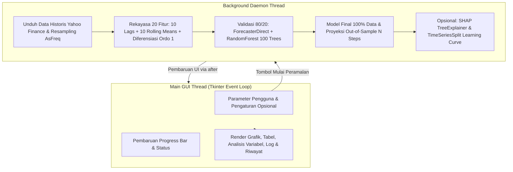

<div align="center">

  

  <p>
    <strong>Aplikasi Desktop Peramalan Deret Waktu (<em>Time Series</em>) Pasar Keuangan Berbasis Machine Learning</strong>
  </p>

  <p>
    Proyeksikan pergerakan harga saham, indeks pasar, komoditas, dan aset kripto secara langsung dari data Yahoo Finance melalui antarmuka desktop modern tanpa memerlukan <em>hyperparameter tuning</em> manual.
  </p>

  <p>
    <a href="https://github.com/Cahyo-Wisanggeni/Yahoo-Finance-Forecaster/releases"></a>
    <a href="https://www.python.org/"></a>
    <a href="https://docs.python.org/3/library/tkinter.html"></a>
    <a href="LICENSE"></a>
    <a href="https://skforecast.org/"></a>
    <a href="https://scikit-learn.org/"></a>
    <a href="https://finance.yahoo.com/"></a>
  </p>

  <p>
    <a href="#pratinjau-aplikasi">Pratinjau</a> &middot;
    <a href="#fitur-utama">Fitur Utama</a> &middot;
    <a href="#rincian-tab-aplikasi">Tab Aplikasi</a> &middot;
    <a href="#panduan-memulai-cepat">Panduan Memulai</a> &middot;
    <a href="CHANGELOG.md">Catatan Perubahan</a>
  </p>

</div>

---

## Daftar Isi

- [Keunggulan & Fitur Utama](#keunggulan--fitur-utama)
- [Pratinjau Aplikasi](#pratinjau-aplikasi)
- [Rincian Tab Aplikasi](#rincian-tab-aplikasi)
- [Panduan Memulai Cepat](#panduan-memulai-cepat)
- [Parameter & Contoh Penggunaan](#parameter--contoh-penggunaan)
- [Arsitektur Machine Learning & Multi-Threading](#arsitektur-machine-learning--multi-threading)
- [Struktur Repositori](#struktur-repositori)
- [Kontribusi & Catatan Perubahan](#kontribusi--catatan-perubahan)
- [Lisensi](#lisensi)

---

## Keunggulan & Fitur Utama

**Peramalan Multi-Langkah Tanpa Akumulasi Galat**<br>
Menggunakan `ForecasterDirect` (`skforecast`) dan `RandomForestRegressor` (100 *trees*) untuk melatih estimator terpisah pada setiap langkah horizon.

**20 Fitur Rekayasa Otomatis**<br>
Membentuk 10 fitur lag (`lag_1`–`lag_10`), 10 *rolling mean* (`roll_mean_1`–`roll_mean_10`), serta diferensiasi orde pertama agar deret harga stasioner.

**Evaluasi Model Transparan**<br>
Memisahkan data latih dan uji (80/20) lalu menghitung MAE dan MAPE secara otomatis sebelum proyeksi *out-of-sample*.

**GUI Ringan & Responsif**<br>
Dibangun dengan `tkinter`/`ttk` tanpa dependensi UI berat, serta berjalan di *background thread* agar antarmuka tidak membeku saat komputasi.

**Analisis SHAP & Learning Curve (Opsional)**<br>
Mendukung interpretabilitas fitur dengan `shap.TreeExplainer` dan evaluasi kurva pembelajaran lewat `TimeSeriesSplit` dari panel Pengaturan.

**Riwayat & Ekspor Data**<br>
Menyimpan riwayat peramalan secara lokal (`forecast_history.json`) dan mendukung ekspor hasil proyeksi ke CSV sekali klik.

**Cakupan Aset Global**<br>
Mendukung seluruh instrumen di Yahoo Finance: saham domestik (`BBCA.JK`), global (`AAPL`), indeks (`^JKSE`), komoditas (`GC=F`), hingga kripto (`BTC-USD`).

---

## Pratinjau Aplikasi

Aplikasi desktop modern dengan kontrol parameter, preset rentang tanggal instan, profil emiten otomatis, metrik evaluasi (MAPE & MAE), serta grafik proyeksi resolusi tinggi:

<div align="center">
  
</div>

---

## Rincian Tab Aplikasi

Seluruh hasil analisis dan panduan dikelompokkan ke dalam enam tab terstruktur:

```text
┌──────────────────────────────────────────────────────────────────────────────────────────────────┐
│ Grafik Prediksi │ Tabel Rincian Prediksi │ Analisis Variabel │ Log Komputasi │ Riwayat │ Tutorial │
└──────────────────────────────────────────────────────────────────────────────────────────────────┘
```

1. **Grafik Prediksi**:
   - Kanvas Matplotlib terintegrasi dengan dua grafik tersinkronisasi:
     - **Grafik Atas**: Evaluasi Model (*Data Latih vs. Data Uji vs. Prediksi Validasi*).
     - **Grafik Bawah**: Hasil Peramalan Akhir (*Data Historis Penuh vs. Proyeksi Multi-Langkah*).
   - Dilengkapi toolbar interaktif Matplotlib (Pan, Zoom, Konfigurasi Subplot, Simpan Gambar) dan tombol **Tampilkan Jendela Pop-up HD**.
2. **Tabel Rincian Prediksi**:
   - Tabel terstruktur berisi nomor urut, tanggal proyeksi, estimasi harga prediksi, selisih nominal, dan persentase perubahan terhadap harga penutupan terakhir.
   - Dilengkapi tombol **Ekspor Hasil ke CSV**.
3. **Analisis Variabel**:
   - Menampilkan grafik **SHAP Feature Importance & Summary Impact** (via `TreeExplainer`) dan/atau **Learning Curve** (via `TimeSeriesSplit` cross-validation) sesuai pengaturan yang diaktifkan.
   - Dilengkapi tombol pop-up HD untuk inspeksi grafik lebih detail.
4. **Log Komputasi**:
   - Aliran log teknis berpenanda waktu (*timestamp*) secara *real-time* yang merinci proses unduh data, pemisahan sampel, dan metrik evaluasi model (MAE & MAPE).
5. **Riwayat**:
   - Menyimpan riwayat peramalan yang pernah dijalankan secara otomatis ke `forecast_history.json` lengkap dengan fitur pencarian, muat ulang hasil, pakai ulang parameter, dan hapus riwayat.
6. **Tutorial**:
   - Panduan singkat bawaan yang menjelaskan langkah-langkah penggunaan aplikasi dari awal hingga akhir.

---

## Panduan Memulai Cepat

### 1. Prasyarat Sistem
- **Python 3.9+** (teruji pada Python 3.9 hingga 3.13).
- Koneksi internet aktif untuk mengunduh data pasar dari Yahoo Finance.

### 2. Kloning Repositori & Instalasi Dependensi

```bash
git clone https://github.com/Cahyo-Wisanggeni/Yahoo-Finance-Forecaster.git
cd Yahoo-Finance-Forecaster

# Membuat dan mengaktifkan virtual environment
python -m venv venv

# Windows (CMD / PowerShell)
venv\Scripts\activate

# Linux / macOS
source venv/bin/activate

# Pasang seluruh paket dependensi
pip install -r requirements.txt
```

### 3. Menjalankan Aplikasi

#### Melalui Terminal (Windows / Linux / macOS):
```bash
python app.py

# Memeriksa versi yang terpasang:
python app.py --version
```

#### Pada Windows (Sekali Klik):
- **Mode Standar (Tanpa Konsol)**: Klik dua kali berkas `run_gui.bat`.
- **Mode Debug (Dengan Output Konsol)**: Klik dua kali berkas `run_gui_debug.bat`.

---

## Parameter & Contoh Penggunaan

Saat menjalankan aplikasi, masukkan lima parameter utama berikut (serta opsi analisis tambahan jika diperlukan):

| Parameter | Format / Pilihan | Keterangan |
|---|---|---|
| **Ticker** | Kode Yahoo Finance | Contoh: `BBCA.JK`, `AAPL`, `^JKSE`, `BTC-USD` (*auto-uppercase*) |
| **Tanggal Mulai** | `YYYY-MM-DD` | Awal rentang data historis (atau pilih *preset* 1–5 Tahun) |
| **Tanggal Selesai** | `YYYY-MM-DD` | Batas akhir data historis yang diunduh |
| **Frekuensi Data** | `B` atau `D` | `B` (*Business Days*) untuk saham/indeks, `D` (*Days*) untuk aset 24/7 seperti kripto |
| **Periode Prediksi** | Bilangan bulat (`1–365`) | Jumlah langkah ke depan yang ingin diproyeksikan (mis. `14` atau `30`) |
| **Pengaturan (Opsional)** | `SHAP analysis`, `Learning Curve` | Mengaktifkan kalkulasi dan visualisasi pada tab **Analisis Variabel** |

<details>
<summary><b>Klik untuk melihat contoh daftar ticker populer &amp; frekuensi yang disarankan</b></summary>

| Kategori | Kode Ticker | Keterangan | Frekuensi Disarankan |
|---|---|---|---|
| Saham Indonesia (IDX) | `BBCA.JK`, `TLKM.JK`, `BMRI.JK` | Bursa Efek Indonesia | `B` |
| Saham Global (US) | `AAPL`, `MSFT`, `NVDA` | NASDAQ / NYSE | `B` |
| Indeks Pasar | `^JKSE`, `^GSPC` | IHSG / S&P 500 | `B` |
| Komoditas | `GC=F`, `CL=F` | Emas / Minyak Mentah | `B` |
| Aset Kripto | `BTC-USD`, `ETH-USD` | Perdagangan 24/7 | `D` |

</details>

---

## Arsitektur Machine Learning & Multi-Threading



| Komponen | Spesifikasi |
|---|---|
| **Strategi Peramalan** | `skforecast.direct.ForecasterDirect` |
| **Estimator Utama** | `RandomForestRegressor(n_estimators=100, random_state=42, n_jobs=-1)` |
| **Fitur Autoregresif** | `lag_1` hingga `lag_10` (10 fitur) |
| **Fitur Rolling Window** | `roll_mean_1` hingga `roll_mean_10` (10 fitur) |
| **Total Prediktor** | 20 fitur deret waktu dengan diferensiasi ordo 1 |
| **Metrik Evaluasi** | MAE (*Mean Absolute Error*) & MAPE (*Mean Absolute Percentage Error*) |
| **Analisis Variabel** | `shap.TreeExplainer` (maks. 200 sampel akhir) & `learning_curve` (`TimeSeriesSplit`) |

---

## Struktur Repositori

```text
Yahoo-Finance-Forecaster/
├── .gitignore             # Aturan pengabaian Git
├── CHANGELOG.md           # Catatan perubahan dan riwayat versi
├── CONTRIBUTING.md        # Panduan kontribusi pengembangan
├── LICENSE                # Lisensi MIT
├── README.md              # Dokumentasi utama proyek
├── requirements.txt       # Daftar dependensi Python
├── app.py                 # Kode sumber utama aplikasi desktop GUI
├── run_gui.bat            # Peluncur senyap 1-klik di Windows
├── run_gui_debug.bat      # Peluncur mode konsol di Windows
└── assets/                # Aset logo & tangkapan layar aplikasi
    ├── logo.png
    ├── logo_v2.png
    ├── gui_preview.png
    └── gui_preview_v2.png
```

---

## Kontribusi & Catatan Perubahan

- **Kontribusi**: Panduan kontribusi tersedia di [CONTRIBUTING.md](CONTRIBUTING.md).
- **Riwayat Rilis**: Seluruh pembaruan fitur dan perbaikan terdokumentasi di [CHANGELOG.md](CHANGELOG.md).

> **Catatan:** Seluruh hasil peramalan dihasilkan secara matematis dari data historis untuk keperluan edukasi, riset, dan analisis teknis, bukan merupakan rekomendasi atau saran investasi finansial.

---

## Lisensi

Didistribusikan di bawah lisensi **[MIT License](LICENSE)**.
