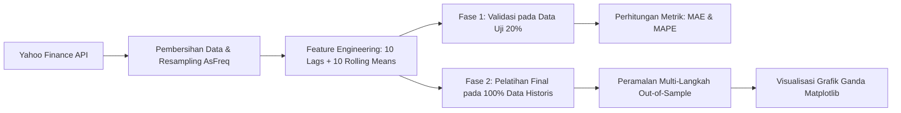

<div align="center">

# Yahoo Finance Forecaster CLI

### Peramalan Deret Waktu (*Time Series Forecasting*) Berbasis Machine Learning Langsung dari Terminal Anda.

[](https://github.com/Cahyo-Wisanggeni/Yahoo-Finance-Forecaster/releases)
[](https://www.python.org/)
[](LICENSE)
[](https://skforecast.org/)
[](https://scikit-learn.org/)
[](https://finance.yahoo.com/)

</div>

---

## Daftar Isi

- [Ringkasan](#ringkasan)
- [Fitur Utama](#fitur-utama)
- [Arsitektur & Alur Kerja](#arsitektur--alur-kerja)
- [Panduan Memulai Cepat](#panduan-memulai-cepat)
  - [Prasyarat](#prasyarat)
  - [Instalasi](#instalasi)
- [Panduan Penggunaan](#panduan-penggunaan)
- [Konfigurasi Model](#konfigurasi-model)
- [Struktur Direktori](#struktur-direktori)
- [Kontribusi](#kontribusi)
- [Lisensi](#lisensi)

---

## Ringkasan

**Yahoo Finance Forecaster CLI** adalah alat peramalan deret waktu berbasis terminal yang dirancang untuk trader, analis kuantitatif, dan praktisi data science. Alat ini mengambil data pasar keuangan secara *real-time* langsung dari Yahoo Finance dan menerapkan *machine learning* (**RandomForestRegressor** dengan strategi **ForecasterDirect**) untuk memproyeksikan harga aset di masa depan.

```text
  █ █ █▀█ █ █ █▀█ █▀█ █
   █  █▀█ █▀█ █ █ █ █ ▀
   ▀  ▀ ▀ ▀ ▀ ▀▀▀ ▀▀▀ ▀
  █▀▀ █ █▀▄ █▀█ █▀▄ █▀▀ █▀▀    █▀▀ █▀█ █▀▄ █▀▀ █▀▀ █▀█ █▀▀ ▀█▀ █▀▀ █▀▄
  █▀  █ █ █ █▀█ █ █ █   █▀     █▀  █ █ █▀▄ █▀  █   █▀█ ▀▀█  █  █▀  █▀▄
  ▀   ▀ ▀ ▀ ▀ ▀ ▀ ▀ ▀▀▀ ▀▀▀    ▀   ▀▀▀ ▀ ▀ ▀▀▀ ▀▀▀ ▀ ▀ ▀▀▀  ▀  ▀▀▀ ▀ ▀
```

---

## Fitur Utama

- **Mendukung Semua Ticker Global**: Bekerja mulus untuk seluruh aset Yahoo Finance, termasuk saham BEI/IDX Indonesia (`BBCA.JK`, `BBRI.JK`, `TLKM.JK`), saham teknologi global AS (`AAPL`, `NVDA`, `MSFT`), komoditas, indeks pasar, hingga mata uang kripto.
- **Cepat Tanpa Tuning Tambahan**: Menggunakan arsitektur optimal terverifikasi (10 Lags + 10 Rolling Means + 100 Trees) yang berlatih hanya dalam beberapa detik dengan akselerasi CPU multi-core (`n_jobs=-1`).
- **Transformasi Stasioneritas Otomatis**: Diferensiasi tingkat pertama (Order-1 Differencing) untuk menghilangkan bias tren non-stasioner pada data harga mentah.
- **Pop-up Grafik Resolusi Tinggi (HD)**:
  1. **Grafik Atas**: Evaluasi Model (*Data Latih vs. Data Uji vs. Prediksi Validasi*).
  2. **Grafik Bawah**: Proyeksi Masa Depan (*Data Historis Penuh vs. Proyeksi Multi-Langkah*).
- **Metrik Evaluasi Komprehensif**: Menampilkan Mean Absolute Error (MAE) dan Mean Absolute Percentage Error (MAPE).

---

## Arsitektur & Alur Kerja



---

## Panduan Memulai Cepat

### Prasyarat

- **Python 3.9+** terpasang di sistem operasi Anda.
- Koneksi internet aktif untuk mengunduh data dari Yahoo Finance.

### Instalasi

```bash
# 1. Masuk ke direktori CLI
cd "Yahoo Finance Forecaster CLI"

# 2. (Opsional) Buat virtual environment
python -m venv venv

# Mengaktifkan di Windows:
venv\Scripts\activate
# Mengaktifkan di Linux / macOS:
source venv/bin/activate

# 3. Instal pustaka yang dibutuhkan
pip install -r requirements.txt
```

---

## Panduan Penggunaan

Jalankan program CLI melalui terminal:

```bash
python main.py
```

Untuk memeriksa versi yang terpasang:
```bash
python main.py --version
```

Isi parameter interaktif yang diminta:

1. **Kode Ticker**: Masukkan simbol ticker (contoh: `BBCA.JK` atau `AAPL`). Program secara otomatis mengonfirmasi ke Yahoo Finance untuk menampilkan Nama Perusahaan, Sektor, dan Industri.
2. **Tanggal Mulai & Tanggal Selesai**: Tentukan rentang data historis dengan format `YYYY-MM-DD` (contoh: `2024-01-01` s/d `2026-11-16`).
3. **Jenis Frekuensi Data**:
   - `B` (*Business Days*): Hanya hari bursa aktif (Senin–Jumat), sangat direkomendasikan untuk saham.
   - `D` (*Calendar Days*): Seluruh hari kalender termasuk akhir pekan.
4. **Jumlah Periode Prediksi (Steps)**: Masukkan jumlah periode hari ke depan yang ingin diproyeksikan (contoh: `30`).

### Contoh Tampilan Terminal

```text
┌────────────────────────────────────────────────────────┐
│  Kode Ticker    : BBCA.JK                              │
│  Nama           : PT Bank Central Asia Tbk             │
│  Sektor         : Financial Services                   │
│  Industri       : Banks - Regional                     │
│  Tanggal Mulai  : 2024-01-01                           │
│  Tanggal Selesai: 2026-11-16                           │
│  Frekuensi      : B (Business Days)                    │
│  Periode (Steps): 30                                   │
└────────────────────────────────────────────────────────┘

[1/2] Melatih Model Peramalan...
┌────────────────────────────────────────────────────┐
│              METRIK EVALUASI INTERNAL              │
│  Mean Absolute Error            : 524.46           │
│  Mean Absolute Percentage Error : 9.32%            │
└────────────────────────────────────────────────────┘

[2/2] Melakukan Peramalan...
Rincian Nilai Hasil Peramalan :
---------------------------------------------
No    | Tanggal         | Prediksi Harga 
---------------------------------------------
1     | 2026-11-17      | 10,250.00
2     | 2026-11-18      | 10,275.00
...   | ...             | ...
30    | 2026-12-28      | 10,480.00
---------------------------------------------
```

---

## Konfigurasi Model

| Parameter | Nilai | Penjelasan Teknis |
|---|---|---|
| **Strategi Peramalan** | `ForecasterDirect` | Melatih estimator khusus untuk tiap horizon langkah prediksi |
| **Estimator Utama** | `RandomForestRegressor` | 100 pohon keputusan (*decision trees*), `n_jobs=-1`, `random_state=42` |
| **Fitur Autoregresif** | `10` | Lag $t-1$ hingga $t-10$ |
| **Fitur Rolling Window** | `10` | Jendela perata-rataan bergerak 1 hingga 10 |
| **Total Fitur Prediktor** | `20` | 10 Lags + 10 Rolling Means |
| **Diferensiasi** | `Ordo 1` | Menjaga kestasioneran data deret waktu |

---

## Struktur Direktori

```text
.
├── .gitignore          # Aturan pengabaian file Git
├── CONTRIBUTING.md     # Panduan kontribusi proyek
├── LICENSE             # Salinan Lisensi MIT
├── README.md           # Dokumentasi edisi CLI
├── requirements.txt    # Daftar dependensi Python
└── main.py             # Titik masuk utama aplikasi CLI
```

---

## Kontribusi

Kontribusi selalu terbuka dan diapresiasi! Silakan baca [CONTRIBUTING.md](CONTRIBUTING.md) untuk panduan pembuatan pull request, pelaporan bug, atau saran pengembangan fitur.

---

## Lisensi

Didistribusikan di bawah **MIT License**. Lihat [LICENSE](LICENSE) untuk teks hukum lengkap.
