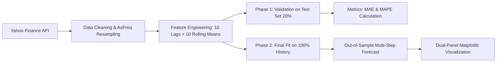

<div align="center">

# 📈 Yahoo Finance Forecaster CLI

### High-performance Machine Learning Time Series Forecasting directly from your terminal.

[](https://www.python.org/)
[](LICENSE)
[](https://skforecast.org/)
[](https://scikit-learn.org/)
[](https://finance.yahoo.com/)
[](CONTRIBUTING.md)

</div>

---

## 📖 Table of Contents

- [Overview](#-overview)
- [Key Features](#-key-features)
- [Architecture & Workflow](#-architecture--workflow)
- [Quick Start](#-quick-start)
  - [Prerequisites](#prerequisites)
  - [Installation](#installation)
- [Usage Walkthrough](#-usage-walkthrough)
- [Model Configuration](#-model-configuration)
- [Project Structure](#-project-structure)
- [Contributing](#-contributing)
- [License](#-license)

---

## 🌟 Overview

**Yahoo Finance Forecaster CLI** is a terminal-based time series forecasting tool built for traders, quantitative analysts, and data science enthusiasts. It fetches real-time financial market data from Yahoo Finance and applies machine learning (**RandomForestRegressor** with **ForecasterDirect**) to predict future stock prices.

```
  █ █ █▀█ █ █ █▀█ █▀█ █
   █  █▀█ █▀█ █ █ █ █ ▀
   ▀  ▀ ▀ ▀ ▀ ▀▀▀ ▀▀▀ ▀
  █▀▀ █ █▀▄ █▀█ █▀▄ █▀▀ █▀▀    █▀▀ █▀█ █▀▄ █▀▀ █▀▀ █▀█ █▀▀ ▀█▀ █▀▀ █▀▄
  █▀  █ █ █ █▀█ █ █ █   █▀     █▀  █ █ █▀▄ █▀  █   █▀█ ▀▀█  █  █▀  █▀▄
  ▀   ▀ ▀ ▀ ▀ ▀ ▀ ▀ ▀▀▀ ▀▀▀    ▀   ▀▀▀ ▀ ▀ ▀▀▀ ▀▀▀ ▀ ▀ ▀▀▀  ▀  ▀▀▀ ▀ ▀
```

---

## ✨ Key Features

- 🌐 **Global Ticker Support**: Works with all Yahoo Finance assets, including IDX stocks (`BBCA.JK`, `BBRI.JK`, `TLKM.JK`), US tech equities (`AAPL`, `NVDA`, `MSFT`), commodities, indices, and crypto.
- ⚡ **Zero-Tuning Speed**: Configured with a proven architecture (10 Lags + 10 Rolling Means + 100 Trees) that trains in seconds with multi-core CPU acceleration (`n_jobs=-1`).
- 🛡️ **Stationarity Transformation**: Automatic Order-1 first-differencing eliminates non-stationary trend bias.
- 📊 **Dual-Panel HD Pop-up**:
  1. **Top Panel**: Model Evaluation curve (*Train vs. Test vs. In-Sample Predictions*).
  2. **Bottom Panel**: Future Projection curve (*Historical Series vs. Multi-Step Future Predictions*).
- 📋 **Evaluation Metrics**: Prints Mean Absolute Error (MAE) and Mean Absolute Percentage Error (MAPE).

---

## 🏗️ Architecture & Workflow



---

## 🚀 Quick Start

### Prerequisites

- **Python 3.9+** installed on your system.
- An active internet connection for Yahoo Finance API requests.

### Installation

```bash
# 1. Clone repository
git clone https://github.com/USERNAME/yahoo-finance-forecaster-cli.git
cd yahoo-finance-forecaster-cli

# 2. (Optional) Create virtual environment
python -m venv venv

# Windows
venv\Scripts\activate
# Linux / macOS
source venv/bin/activate

# 3. Install dependencies
pip install -r requirements.txt
```

---

## 💻 Usage Walkthrough

Launch the CLI tool:

```bash
python main.py
```

Follow the interactive prompts:

1. **Kode Ticker**: Enter ticker symbol (e.g., `BBCA.JK` or `AAPL`). Automatically queries Yahoo Finance to display Company Name, Sector, and Industry.
2. **Start Date & End Date**: Historical window in `YYYY-MM-DD` format (e.g., `2024-01-01` to `2026-11-16`).
3. **Frekuensi Data**:
   - `B` (*Business Days*): Excludes weekends, recommended for equity markets.
   - `D` (*Calendar Days*): Continuous daily timeline.
4. **Forecast Steps**: Number of future periods to predict (e.g., `30`).

### Sample Terminal Output

```text
┌────────────────────────────────────────────────────────┐
│  Kode Ticker    : BBCA.JK                              │
│  Nama           : PT Bank Central Asia Tbk             │
│  Sektor         : Financial Services                   │
│  Industri       : Banks - Regional                     │
│  Start Date     : 2024-01-01                           │
│  End Date       : 2026-11-16                           │
│  Frekuensi      : B (Business Days)                    │
│  Forecast Steps : 30                                   │
└────────────────────────────────────────────────────────┘

[1/2] Melatih Model Peramalan...
┌────────────────────────────────────────────────────┐
│              METRIK EVALUASI INTERNAL              │
│  Mean Absolute Error            : 524.46           │
│  Mean Absolute Percentage Error : 9.32%            │
└────────────────────────────────────────────────────┘

[2/2] Melakukan Peramalan...
Rincian Nilai Hasil Peramalan :
---------------------------------------------
No    | Tanggal         | Prediksi Harga 
---------------------------------------------
1     | 2026-11-17      | 10,250.00
2     | 2026-11-18      | 10,275.00
...   | ...             | ...
30    | 2026-12-28      | 10,480.00
---------------------------------------------
```

---

## ⚙️ Model Configuration

| Parameter | Value | Details |
|---|---|---|
| **Forecaster Strategy** | `ForecasterDirect` | Trains dedicated estimators for each forward step |
| **Estimator** | `RandomForestRegressor` | 100 decision trees, `n_jobs=-1`, `random_state=42` |
| **Autoregressive Lags** | `10` | Lags $t-1$ through $t-10$ |
| **Rolling Features** | `10` | Rolling mean windows 1 through 10 |
| **Total Features** | `20` | 10 Lags + 10 Rolling Means |
| **Differentiation** | `Order 1` | First-difference transform for stationarity |

---

## 📁 Project Structure

```text
.
├── .gitignore          # Git exclusion rules
├── CONTRIBUTING.md     # Guidelines for contributors
├── LICENSE             # MIT License
├── README.md           # Project documentation
├── requirements.txt    # Production dependencies
└── main.py             # CLI application entrypoint
```

---

## 🤝 Contributing

Contributions are welcome! Please read [CONTRIBUTING.md](CONTRIBUTING.md) for details on submitting pull requests, reporting bugs, or suggesting feature improvements.

---

## 📜 License

Distributed under the **MIT License**. See [LICENSE](LICENSE) for full legal text.
