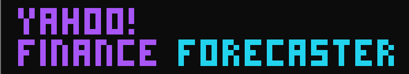
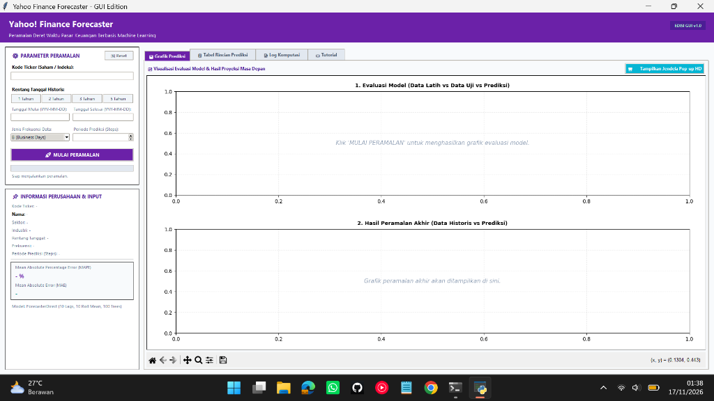
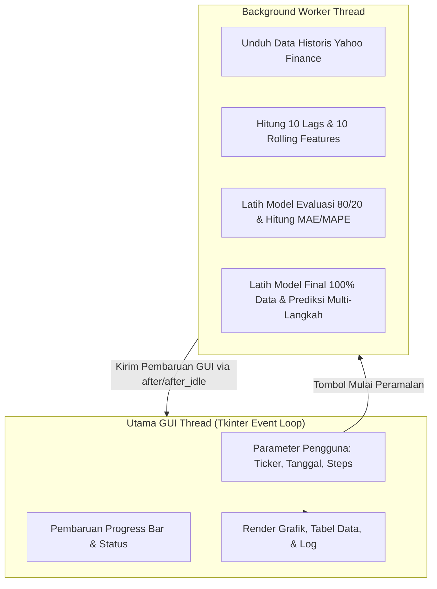

<div align="center">



### Aplikasi Desktop Modern untuk Peramalan Deret Waktu (*Time Series Forecasting*) Harga Saham Berbasis Machine Learning.

[](https://www.python.org/)
[](https://docs.python.org/3/library/tkinter.html)
[](LICENSE)
[](https://skforecast.org/)
[](https://scikit-learn.org/)
[](https://github.com/)

</div>

---

## Daftar Isi

- [Ringkasan](#ringkasan)
- [Pratinjau Aplikasi](#pratinjau-aplikasi)
- [Fitur Utama](#fitur-utama)
- [Rincian Tab Aplikasi](#rincian-tab-aplikasi)
- [Arsitektur & Multi-Threading](#arsitektur--multi-threading)
- [Panduan Memulai Cepat](#panduan-memulai-cepat)
  - [Prasyarat](#prasyarat)
  - [Instalasi](#instalasi)
  - [Menjalankan Aplikasi](#menjalankan-aplikasi)
- [Konfigurasi Model](#konfigurasi-model)
- [Struktur Direktori](#struktur-direktori)
- [Kontribusi](#kontribusi)
- [Lisensi](#lisensi)

---

## Ringkasan

**Yahoo Finance Forecaster GUI** menyajikan antarmuka grafis desktop modern yang elegan dan responsif untuk memproyeksikan harga saham, indeks pasar, komoditas, dan aset kripto menggunakan data langsung dari Yahoo Finance.

Ditenagai oleh **Random Forest Regressor** (100 pohon keputusan) dan framework **skforecast** (`ForecasterDirect`), aplikasi ini menggabungkan variabel lag autoregresif ($t-1 \dots t-10$) dengan rata-rata bergerak (*rolling window averages* $1 \dots 10$) serta diferensiasi ordo pertama untuk menghasilkan proyeksi harga multi-langkah ke depan yang akurat dan stabil.

## Pratinjau Aplikasi

<div align="center">
  
</div>

---

## Fitur Utama

- **GUI Asli yang Ringan**: Dibangun menggunakan pustaka bawaan Python `tkinter` dan `ttk` dengan desain palet warna ungu-cyan modern. Tidak memerlukan dependensi UI pihak ketiga yang berat (seperti PyQt atau Electron).
- **Multi-Threading Bebas Macet (Non-Blocking)**: Seluruh beban komputasi berat (pengambilan data jaringan, pelatihan model, dan kalkulasi prediksi) berjalan secara asinkron di *background daemon thread*. Antarmuka tetap lancar dan tidak pernah memicu "Not Responding".
- **Input Ticker Cerdas**: Konversi otomatis huruf kapital secara *real-time* saat pengetikan. Otomatis mengenali Nama Perusahaan, Sektor, dan Industri secara langsung saat proses berjalan.
- **Tombol Preset Tanggal Cepat**: Tombol sekali klik (`1 Tahun`, `2 Tahun`, `3 Tahun`, `5 Tahun`) untuk mengisi rentang tanggal historis secara instan.
- **Ekspor Spreadsheet CSV**: Menyimpan seluruh baris hasil proyeksi peramalan ke format CSV (`prediksi_<ticker>_<timestamp>.csv`) untuk analisis lanjutan di Excel atau Google Sheets.
- **Fitur Reset Form Sekali Klik**: Tombol reset praktis untuk membersihkan seluruh kotak input dan mengembalikan tabel serta grafik ke kondisi awal.

---

## Rincian Tab Aplikasi

Aplikasi mengorganisasi seluruh hasil analisis ke dalam empat tab khusus:

```text
┌────────────────────────────────────────────────────────────────────────┐
│   Grafik Prediksi  │   Tabel Rincian  │   Log  │   Tutorial    │
└────────────────────────────────────────────────────────────────────────┘
```

1. ** Grafik Prediksi**:
   - Kanvas Matplotlib terintegrasi dengan dua grafik tersinkronisasi:
     - **Grafik Atas**: Evaluasi Model (*Data Latih vs. Data Uji vs. Prediksi Validasi*).
     - **Grafik Bawah**: Proyeksi Masa Depan (*Data Historis Penuh vs. Proyeksi Multi-Langkah*).
   - Dilengkapi toolbar interaktif Matplotlib (Pan, Zoom, Konfigurasi Subplot, Simpan Gambar) dan tombol ** Tampilkan Jendela Pop-up HD** untuk inspeksi detail resolusi tinggi.
2. ** Tabel Rincian Prediksi**:
   - Tabel terstruktur berisi nomor urut, tanggal proyeksi, estimasi harga prediksi, nominal selisih harga, dan persentase perubahan terhadap harga penutupan terakhir.
   - Dilengkapi tombol ** Ekspor Hasil ke CSV**.
3. ** Log Komputasi**:
   - Aliran log terminal *real-time* dengan penanda waktu (*timestamp*) akurat yang merinci proses download data, pemisahan sampel, dan metrik evaluasi model (MAE & MAPE).
4. ** Tutorial**:
   - Panduan komprehensif bawaan yang menjelaskan langkah-langkah penggunaan aplikasi dari awal hingga akhir.

---

## Arsitektur & Multi-Threading



---

## Panduan Memulai Cepat

### Prasyarat

- **Python 3.9+** (didukung penuh pada Python 3.10, 3.11, 3.12, dan 3.13).
- Akses internet aktif untuk koneksi ke Yahoo Finance API.

### Instalasi

```bash
# 1. Masuk ke direktori GUI
cd "Yahoo Finance Forecaster GUI"

# 2. (Opsional) Buat dan aktifkan virtual environment
python -m venv venv

# Pada Windows:
venv\Scripts\activate
# Pada Linux / macOS:
source venv/bin/activate

# 3. Pasang paket dependensi
pip install -r requirements.txt
```

---

### Menjalankan Aplikasi

#### Pada Windows:
- **Mode Standar (Tanpa Terminal)**: Klik dua kali file `run_gui.bat`.
- **Mode Debug (Dengan Terminal)**: Klik dua kali file `run_gui_debug.bat`.

#### Melalui Terminal (Semua Sistem Operasi):
```bash
python app.py
```

---

## Konfigurasi Model

| Parameter | Spesifikasi | Kegunaan |
|---|---|---|
| **Strategi Multi-Langkah** | `ForecasterDirect` | Model khusus untuk tiap horizon peramalan guna menghindari akumulasi galat |
| **Estimator Utama** | `RandomForestRegressor` | Ensemble 100 pohon keputusan (`n_jobs=-1`, `random_state=42`) |
| **Lag Autoregresif** | 10 (`lag_1` s/d `lag_10`) | Menangkap memori momentum pergerakan harga terbaru |
| **Rata-Rata Bergerak** | 10 (`roll_mean_1` s/d `roll_mean_10`) | Menangkap sinyal tren yang diperhalus dari berbagai rentang waktu |
| **Transformasi Stasioner** | Diferensiasi Ordo 1 | Mengeliminasi tren non-stasioner pada data harga mentah |
| **Pemisahan Latih / Uji** | 80% Latih / 20% Uji | Evaluasi performa model internal sebelum peramalan final |

---

## Struktur Direktori

```text
.
├── .gitignore            # Aturan pengabaian Git
├── CONTRIBUTING.md       # Panduan kontribusi pengembangan
├── LICENSE               # Lisensi MIT
├── README.md             # Dokumentasi edisi GUI
├── requirements.txt      # Daftar dependensi Python
├── run_gui.bat           # Peluncur senyap 1-klik di Windows
├── run_gui_debug.bat     # Peluncur mode konsol di Windows
└── app.py                # Kode sumber utama aplikasi GUI
```

---

## Kontribusi

Kontribusi berupa laporan bug, masukan perbaikan UI/UX, maupun penambahan fitur baru sangat kami nantikan. Silakan pelajari panduan pada [CONTRIBUTING.md](CONTRIBUTING.md).

---

## Lisensi

Aplikasi ini didistribusikan di bawah naungan **MIT License**. Kunjungi file [LICENSE](LICENSE) untuk informasi legalitas selengkapnya.
