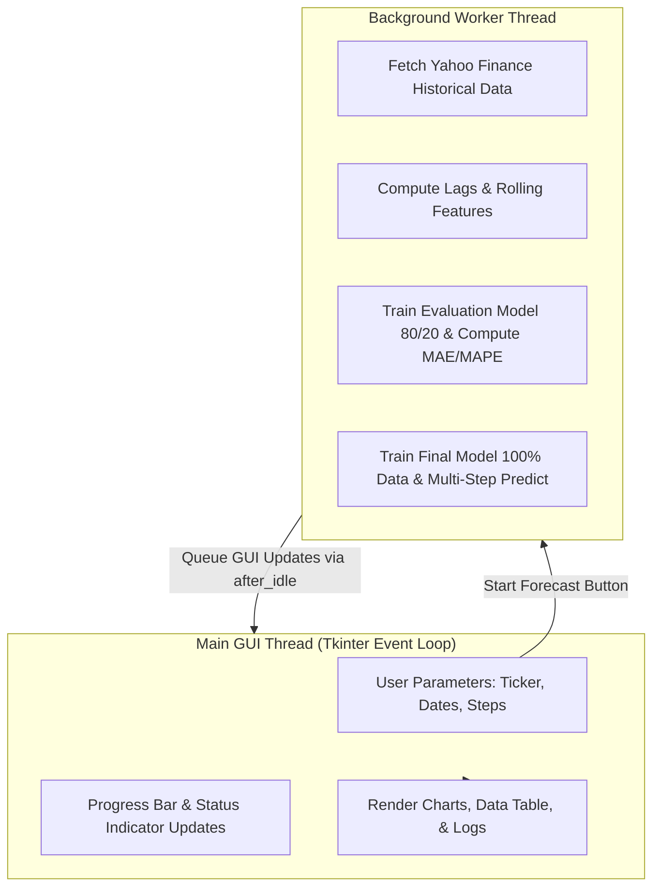

<div align="center">

# 📊 Yahoo Finance Forecaster - GUI Edition

### Modern Desktop Application for Machine Learning Time Series Stock Price Forecasting.

[](https://www.python.org/)
[](https://docs.python.org/3/library/tkinter.html)
[](LICENSE)
[](https://skforecast.org/)
[](https://scikit-learn.org/)
[](https://github.com/)

</div>

---

## 📖 Table of Contents

- [Overview](#-overview)
- [Key Features](#-key-features)
- [Tab Breakdown](#-tab-breakdown)
- [Architecture & Background Threading](#-architecture--background-threading)
- [Quick Start](#-quick-start)
  - [Prerequisites](#prerequisites)
  - [Installation](#installation)
  - [Launching the App](#launching-the-app)
- [Model Configuration](#-model-configuration)
- [Project Structure](#-project-structure)
- [Contributing](#-contributing)
- [License](#-license)

---

## 🌟 Overview

**Yahoo Finance Forecaster GUI** provides a sleek desktop interface for predicting stock, index, commodity, and crypto prices using data directly from Yahoo Finance.

Powered by **Random Forest Regressor** (100 decision trees) and **skforecast** (`ForecasterDirect`), it couples autoregressive lag features ($t-1 \dots t-10$) with rolling window averages ($1 \dots 10$) and first-order differencing to deliver robust multi-step forward projections.

---

## ✨ Key Features

- 🖥️ **Lightweight Native GUI**: Built with Python's built-in `tkinter` and `ttk` with custom modern purple-cyan styling. No heavy third-party UI dependencies (like PyQt or Electron) required.
- 🧵 **Non-Blocking Multi-Threading**: All computational workloads (network fetching, model training, and projections) run asynchronously in daemon worker threads. The GUI remains smooth and never triggers "Not Responding".
- 🔠 **Smart Ticker Input**: Automatic real-time uppercase conversion regardless of Caps Lock status. Automatically discovers company name, sector, and industry upon execution.
- 📅 **1-Click Date Presets**: Quick buttons (`1 Tahun`, `2 Tahun`, `3 Tahun`, `5 Tahun`) automatically set optimal historical date windows.
- 💾 **Spreadsheet Export**: Export complete multi-step projection tables directly to CSV (`forecast_results_<ticker>.csv`).
- 🔄 **One-Click Reset**: Dedicated reset button to immediately clear forms and revert the app to its clean initial state.

---

## 📑 Tab Breakdown

The application organizes results into four dedicated tabs:

```
┌────────────────────────────────────────────────────────────────────────┐
│  📊 Grafik Prediksi  │  📋 Tabel Rincian  │  📝 Log  │  📖 Tutorial    │
└────────────────────────────────────────────────────────────────────────┘
```

1. **📊 Grafik Prediksi**:
   - Embedded Matplotlib canvas with two synchronized charts:
     - **Top Chart**: Model evaluation (*Train vs. Test vs. In-Sample Predictions*).
     - **Bottom Chart**: Out-of-sample forward projections (*Historical Data vs. Future Forecast*).
   - Includes full Matplotlib toolbar (Pan, Zoom, Subplot Configuration, Save Figure) plus a **🖥️ Tampilkan Jendela Pop-up HD** button for high-resolution inspection.
2. **📋 Tabel Rincian Prediksi**:
   - Structured table listing projection date, predicted price, nominal price change, and percentage change relative to the last closing price.
   - Includes **💾 Ekspor Hasil ke CSV** button.
3. **📝 Log Komputasi**:
   - Real-time terminal log stream with precise timestamps detailing data retrieval, sample sizes, and model evaluation metrics (MAE & MAPE).
4. **📖 Tutorial**:
   - Built-in comprehensive user manual and step-by-step instructions.

---

## 🏗️ Architecture & Background Threading



---

## 🚀 Quick Start

### Prerequisites

- **Python 3.9+** (Python 3.10, 3.11, 3.12, 3.13 fully supported).
- Internet access for Yahoo Finance API connections.

### Installation

```bash
# 1. Clone repository
git clone https://github.com/USERNAME/yahoo-finance-forecaster-gui.git
cd yahoo-finance-forecaster-gui

# 2. (Optional) Create and activate virtual environment
python -m venv venv

# Windows
venv\Scripts\activate
# Linux / macOS
source venv/bin/activate

# 3. Install required libraries
pip install -r requirements.txt
```

---

### Launching the App

#### On Windows:
- **Standard Mode**: Double-click `run_gui.bat` (launches GUI directly without terminal window).
- **Debug Mode**: Double-click `run_gui_debug.bat` (keeps terminal open for real-time debug output).

#### From Terminal (Cross-Platform):
```bash
python app.py
```

---

## ⚙️ Model Configuration

| Parameter | Specification | Purpose |
|---|---|---|
| **Multi-Step Strategy** | `ForecasterDirect` | Dedicated model per forecast step to eliminate error accumulation |
| **Estimator** | `RandomForestRegressor` | Ensemble of 100 decision trees (`n_jobs=-1`, `random_state=42`) |
| **Autoregressive Lags** | 10 (`lag_1` to `lag_10`) | Captures recent momentum and price memory |
| **Rolling Window Averages** | 10 (`roll_mean_1` to `roll_mean_10`) | Captures multi-scale smoothed trend signals |
| **Stationarity** | Differencing Order 1 | Removes non-stationary trends from raw prices |
| **Train / Test Split** | 80% Train / 20% Test | Internal model evaluation before full-history training |

---

## 📁 Project Structure

```text
.
├── .gitignore            # Git exclusion rules
├── CONTRIBUTING.md       # Guidelines for contributors
├── LICENSE               # MIT License
├── README.md             # Project documentation
├── requirements.txt      # Production dependencies
├── run_gui.bat           # Windows 1-click silent launcher
├── run_gui_debug.bat     # Windows 1-click launcher with console
└── app.py                # Main GUI application entrypoint
```

---

## 🤝 Contributing

Contributions are welcome! Please see [CONTRIBUTING.md](CONTRIBUTING.md) for details on bug reports, feature requests, and pull request guidelines.

---

## 📜 License

Distributed under the **MIT License**. See [LICENSE](LICENSE) for more information.
